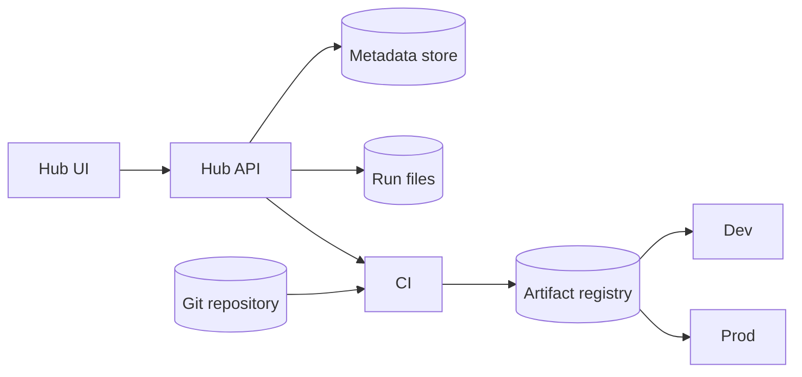

# Architecture

The hub records the work. Version control holds the code. Production calls a released artifact.

## Components

| Component | Responsibility |
| --- | --- |
| Hub UI | Algorithms, investigations, the run form, versions |
| Hub API | Creates records, enforces statuses, triggers release |
| Metadata store | Algorithm, investigation, run, version records |
| Run files | One folder per investigation, one subfolder per run |
| Git repository | One per algorithm. Source, tests, contract, adapter |
| CI | Builds a candidate artifact from a commit. Runs the checks |
| Artifact registry | Candidate and released artifacts |
| Dev | Development environment, on the shop rig. Pinned to the current release or a candidate |
| Prod | Production environment, on customer rigs. Pinned to a released version |



Arrows mean “calls or reads.”

## The contract

Production sees one interface per algorithm:

```python
class Algorithm:
    def run(self, inputs: SensorFrame) -> BalanceCorrection: ...
```

Research code may be MATLAB or a researcher’s Python. An adapter sits behind `run`. Translating MATLAB is out of scope. Isolating it is the design.

```http
POST /algorithms/wheel-balance/v2/predict
{ "radial_force": 12.4, "lateral_force": 3.1, "wheel_angle": 27.2, "wheel_speed": 8.3 }
```

```json
{ "correction_angle": 31.8, "correction_weight": 1.7, "lateral_adjustment": -0.42, "confidence": 0.94 }
```

## Where code lives

| Repository | Holds | A release means |
| --- | --- | --- |
| `research-hub` | UI, API, lifecycle | A hub deploy |
| `wheel-balance` | That algorithm only | A new version of Wheel Balance |
| `algorithm-contract` | Contract types and the shared CI checks | Both sides adopt the change |

One repository per algorithm, separate from the hub. They release on different clocks. A monorepo of algorithms is acceptable for a small team if each algorithm keeps its own tags and CI path. The demo keeps `algorithms/wheel_balance` beside the hub so it runs from one folder; that is a shortcut.

## Principles

1. Version control holds the code. The hub holds pointers and records.
2. A version is a release. Candidates never get a number.
3. The bytes tested in the shop are the bytes production runs.
4. The run form follows the contract, so runs are replayable.
5. Researchers keep their tools inside the investigation. The standard is the contract, the run form, and the release.

## Why the bar is high

Sensor data goes in, a decision comes out, an actuator moves, and the next reading reflects it. A bad release is a bad move in a service bay. Over time a release also wants a latency bound, calibration and sensor-validity checks, observability, and a safe default when confidence is low. The prototype implements replay on stored runs. The rest is the roadmap.
