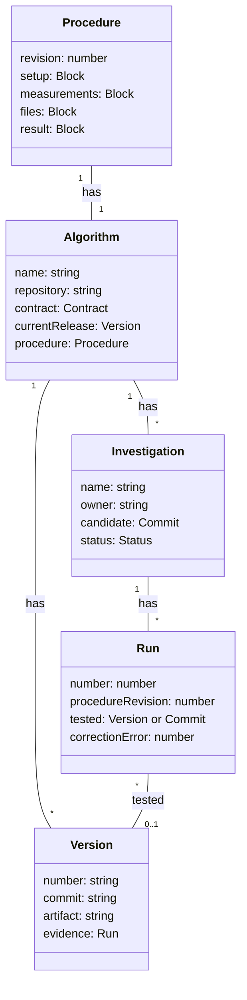

# Models

Each box is a record. A line is an association, with how many on each side. It is not a step.

`1` is one. `*` is zero or more. `0..1` is optional. `tested` is the version or the candidate a run recorded.

`Contract`, `Commit`, `Status`, and `Block` are field types. They are not records.
